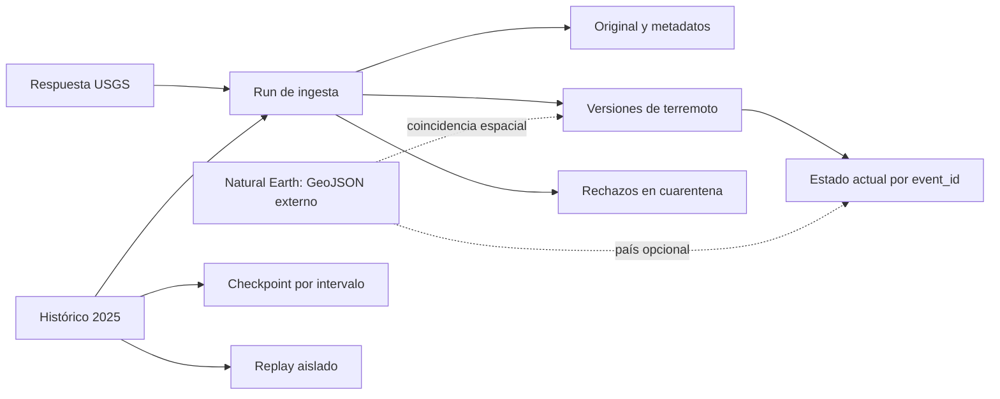
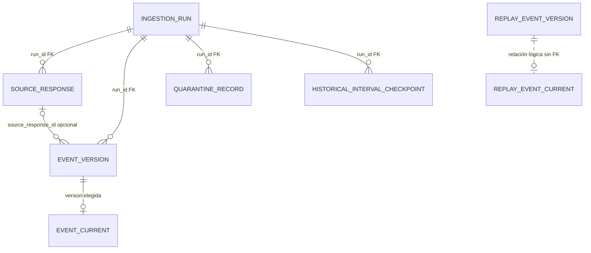

# Modelo conceptual, lógico y físico

El esquema ejecutable está en
[001_ingestion_schema.sql](../consumer/src/migrations/001_ingestion_schema.sql).
Esta descripción contrasta ese DDL con las restricciones e índices presentes
en PostgreSQL mediante consultas `SELECT` el 18-11-2026 a las 20:12 UTC.
Los resultados de esa inspección están en la
[auditoría de procedencia](../evidence/002-ingesta-usgs-persistencia/audit-monitor-1723-20261118.json).

## Conceptual: qué representa cada dato

El grano de **evento** es el ID USGS; el de **versión** es
`(event_id, updated)`. Una ejecución puede descargar una respuesta con muchos
features, publicar solo versiones nuevas y registrar rechazos. El estado
actual elige la versión más reciente sin perder las anteriores. Un evento
puede tener cero o un país asignado en el estado analítico; el punto puede
estar en el mar o fuera del catálogo. Natural Earth es un **GeoJSON externo**
que carga el consumidor con GeoPandas; su índice espacial está en memoria,
no en PostgreSQL. `country_id` (`ADM0_A3`) y `country_name` son atributos
guardados, sin FK a una tabla de países.

## Lógico: entidades y cardinalidades

Una `source_response` pertenece a exactamente un run; una versión puede
apuntar a cero o una respuesta (`source_response_id` permite NULL). Cada fila
de `event_current` apunta a una versión, aunque la base **no** impone `UNIQUE`
sobre `event_version_id`: la relación «una versión, como máximo un estado
actual» depende del código. `quarantine_record.source_response_id` es texto
sin FK en el esquema actual. Replay usa otro topic Kafka y **tablas separadas**;
no hay FK entre sus dos tablas ni hacia `ingestion_run`.

| Tabla | Grano | PK y claves únicas | FK y tipos relevantes |
| --- | --- | --- | --- |
| `ingestion_run` | Una ejecución de live, histórico o replay | `run_id TEXT` PK | `mode TEXT` con CHECK; tiempos `TIMESTAMPTZ`, contadores `INTEGER`. |
| `source_response` | Una respuesta original descargada | `response_id TEXT` PK | `run_id → ingestion_run`; `payload_jsonb JSONB`, URL y tiempos UTC. |
| `event_version` | Una revisión USGS de un ID | `event_version_id BIGSERIAL` PK; `UNIQUE(event_id, updated)` | `run_id → ingestion_run`; `source_response_id → source_response` nullable; `updated/event_time BIGINT` en ms UTC; magnitud, lon/lat y profundidad `DOUBLE PRECISION`; originales `JSONB`. |
| `event_current` | Estado elegido de un `event_id` | `event_id TEXT` PK | `event_version_id → event_version`; `current_updated BIGINT`, país nullable, coordenadas/profundidad `DOUBLE PRECISION`, original/normalizado `JSONB`. |
| `quarantine_record` | Un rechazo con motivo y original | `quarantine_id BIGSERIAL` PK | `run_id → ingestion_run`; `source_response_id TEXT` **sin FK**; `original_jsonb JSONB`, tiempo `TIMESTAMPTZ`. |
| `historical_interval_checkpoint` | Un intervalo confirmado por run | `(run_id, interval_start)` PK | `run_id → ingestion_run`; `interval_start TEXT`, contadores `INTEGER`, cierre UTC. |
| `replay_event_version` | Una versión reenviada | `(event_id, updated)` PK | Sin FK; fecha original `BIGINT` y reenvío `TIMESTAMPTZ`. |
| `replay_event_current` | Estado de replay por ID | `event_id TEXT` PK | Sin FK; `current_updated BIGINT`, `replay_at TIMESTAMPTZ`. |

Para un mensaje Kafka defectuoso, `payload_reference` y el `run_id` de
cuarentena codifican topic, partición y offset; `quarantine_record` conserva
además motivo y original. La deduplicación de datos reales se apoya en la
clave única de `event_version`; el productor también evita publicar versiones
ya vistas.
Los valores de magnitud y profundidad nulos se guardan como NULL, no como
cero. Véanse [calidad](ANALISIS-CALIDAD.md) y
[diccionario](DICCIONARIO-DATOS.md).

## Físico: índices existentes y consultas

La consulta de índices en `pg_index`/`pg_class` confirma estos árboles B-tree;
los PK y UNIQUE también crean índices. Las columnas numéricas de fecha de
evento son milisegundos UTC, mientras que las marcas de ingesta usan
`TIMESTAMPTZ`.

| Índice o restricción | Consulta relacionada | Lectura del alcance |
| --- | --- | --- |
| `event_version_event_id_updated_key` (`UNIQUE(event_id,updated)`) | `ON CONFLICT` y búsqueda de versiones de un ID | Impide versiones repetidas y da acceso por prefijo `event_id`. |
| `event_version_pkey` (`event_version_id`) | Join de `/api/eventos` entre estado y versión | Identifica la versión seleccionada. |
| `event_current_event_time_idx` (`event_time`) | Ventanas UTC de `/api/eventos` y `/api/estadisticas` | Filtra tiempo sin país. |
| `event_current_country_time_idx` (`country_id,event_time`) | País + ventana en mapa y estadísticas | La primera columna es útil cuando se aplica país. |
| `source_response_run_received_idx` (`run_id,received_at`) | Respuestas de una ejecución y procedencia | Orden y búsqueda por run. |
| `ingestion_run_status_started_idx` (`status,started_at`) | Búsquedas por estado/inicio de runs | **No** cubre exactamente el `ORDER BY finished_at` de `/api/salud`. |
| `quarantine_reason_created_idx` (`reason_code,created_at`) | Revisión de rechazos por motivo y fecha | No es el filtro usado por el contador de `/api/salud`. |
| `historical_interval_checkpoint_pkey` (`run_id,interval_start`) | Reanudación del batch por run e intervalo | Evita confirmar dos veces el mismo intervalo. |
| `replay_event_current_time_idx` (`event_time`) | Ventanas del modo replay | Replay queda separado de live. |

La medición previa de una consulta horaria de 2025 observó 0,070 ms y tres
bloques con `event_current_event_time_idx`, frente a 6,622 ms y 2.688 bloques
en recorrido secuencial forzado. Es una medición puntual con cachés distintas,
no una garantía de aceleración general; el método está en
[complejidad y costes](ANALISIS-COMPLEJIDAD-COSTES.md).

## Revisión SQL: hechos, mediciones y propuestas

**Hecho confirmado.** El DDL declara `UNIQUE(event_id, updated)` en
`event_version` y además crea `event_version_event_updated_idx` sobre las
**mismas columnas y orden**. PostgreSQL tiene ambos índices: el único
`event_version_event_id_updated_key` y el explícito no único. El índice único
ya puede resolver búsquedas por esas columnas y hacer cumplir la clave.

**Medición de este corte.** `pg_relation_size` dio **1.245.184 bytes** para el
índice único y **1.269.760 bytes** para el explícito; este último ocupa
aproximadamente **1,21 MiB** adicionales. `pg_stat_user_indexes` mostraba
656 y 39 lecturas de índice, respectivamente, desde el último reinicio de
estadísticas, cuya fecha no se midió. Eso no demuestra que el explícito sea
necesario. Mantener ambos añade almacenamiento y trabajo de escritura; no se
midió el coste incremental de cada INSERT.

**Propuesta, sin aplicar durante el monitor.** Tras la medición y con copia
de seguridad, eliminar el índice explícito mediante una migración controlada
y repetir `EXPLAIN (ANALYZE, BUFFERS)` de deduplicación, consulta por ID y
carga de escritura. No se modificó ningún índice en esta revisión.

**Hecho confirmado.** `ensure_schema()` ejecuta el archivo SQL completo al
arrancar el consumidor y al iniciar el batch histórico. Incluye
`CREATE ... IF NOT EXISTS`, varios `ALTER TABLE ... ADD COLUMN IF NOT EXISTS`,
`DROP/ADD` de dos CHECK, dos `UPDATE` de la marca sintética para IDs
`controlled-*` y una reconciliación condicionada del contador histórico.
No se ejecuta por cada mensaje, pero se repite en cada arranque. No medimos
en esta revisión su tiempo ni posibles esperas de lock.

**Propuestas para una revisión posterior:** introducir migraciones numeradas
de una sola aplicación; dejar la reparación del contador heredado en una
migración propia; estudiar `EXPLAIN` del último run de `/api/salud` antes de
crear un índice por `finished_at`; comprobar integridad existente antes de
añadir FK a cuarentena o replay. Son mejoras posibles, no cambios ejecutados
ni ganancias medidas. Ninguna de estas acciones se hizo durante la prueba de
24 horas.
